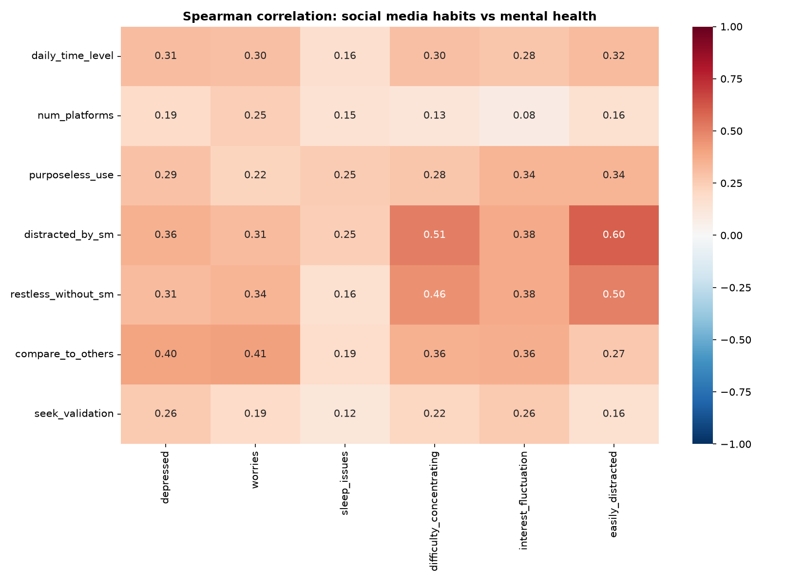

# Social Media Use and Mental Health: Correlation and Prediction
*by Jane Le (started August 2026)*
A small data science project looking at how social media habits relate to self-reported mental health, and whether those habits can predict who reports feeling depressed often.



## Why this project
I love doom-scrolling on social media, and I have a genuine interest in subjects like mental health, human psychology, and social behaviours. So I thought "Why not try to see if there's any relationship between social media usage and mental health?" Hence this mini project :>

## Questions
1. How is daily social media time related to depression, worry, sleep problems and concentration?
2. Using only social media habits and basic demographics, can we predict whether someone reports feeling depressed often (score 4 or 5 out of 5)?

## Data
[Social Media and Mental Health](https://www.kaggle.com/datasets/souvikahmed071/social-media-and-mental-health) (Kaggle, Souvik Ahmed, 2022).

An online survey with 481 responses: age, gender, occupation, platforms used, average daily time on social media, usage habits (purposeless use, distraction, social comparison, seeking validation) and 1 to 5 self-ratings of mental health symptoms.
A copy is in `data/smmh.csv`.

I first looked at the Public Health Agency of Canada's 2018 HBSC report on adolescents' problematic social media use, but it only publishes summary results, not respondent-level data, so I used this public survey instead.

## Method
- **Cleaning:** removed 3 respondents who don't use social media, grouped free-text gender answers, encoded daily time as an ordinal 0 to 5 scale, counted platforms per person.
- **EDA:** distributions of time, age and depression score; mean depression score by time bucket with 95% CIs.
- **Correlation:** Spearman rank correlation (the answers are ordinal), with p-values.
- **Prediction:** binary target `high_depression` (score 4 or 5, 46% of respondents). The features are social media habits and demographics only. I left out the other mental health items to avoid leakage, since they're symptoms measured at the same time as the target.
- **Model:** logistic regression (with standardized features) in scikit-learn, compared against a majority-class baseline. Text columns are turned into dummy variables.
- **Evaluation:** 5-fold cross-validation on an 80% training split, then one final check on the 20% held-out test set.

## Results

| Model | CV accuracy | CV ROC AUC | Test ROC AUC |
|---|---|---|---|
| Baseline (majority class) | 0.54 | 0.50 | 0.50 |
| Logistic regression | 0.68 | 0.76 | 0.70 |

- Daily social media time has a moderate positive correlation with depression (Spearman rho = 0.31), worries (0.30) and difficulty concentrating (0.30), and a weaker one with sleep issues (0.17).
- Mean depression score rises steadily from 2.0 (less than 1 hour a day) to 3.8 (more than 5 hours a day).
- *How* people use social media matters more than how long: comparing yourself to others (rho = 0.40) and getting distracted by social media (0.36) correlate more strongly with depression than daily time does.
- Logistic regression clearly beats the baseline. Comparing yourself to others has by far the largest coefficient (0.59), about twice that of daily time (0.31).

## Limitations
- **Correlation, not causation.** People who already feel low may spend more time on social media.
- **Convenience sample.** It's an online form with mostly university students in their early 20s, so it isn't representative of any population.
- **Single self-reported items.** "How often do you feel depressed?" is not a clinical diagnosis.
- **Small data.** About 380 training rows and 96 test rows, so metrics have wide uncertainty (the CV scores vary from fold to fold).
- **Threshold choice.** Splitting a 1 to 5 score at 4 is a modelling decision; other cut-offs would change the numbers.

## How to run
```bash
pip install -r requirements.txt
jupyter notebook analysis.ipynb
```
Figures are saved to `figures/`.

## Possible next steps
- Use ordinal regression to predict the full 1 to 5 score.
- Try random forest or decision tree to see if they perform better.
